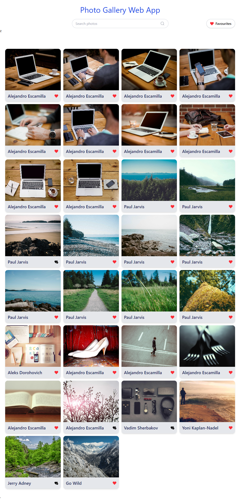
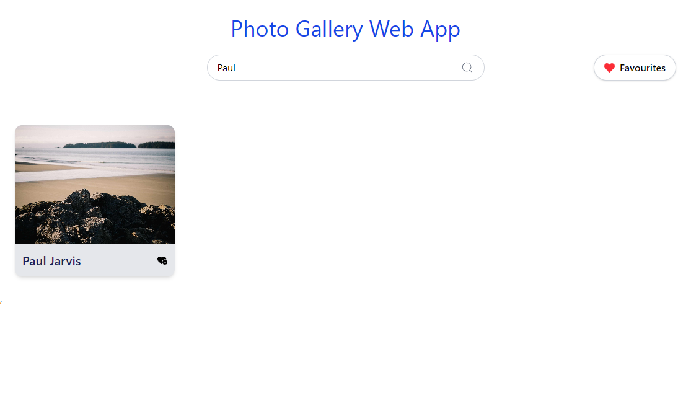
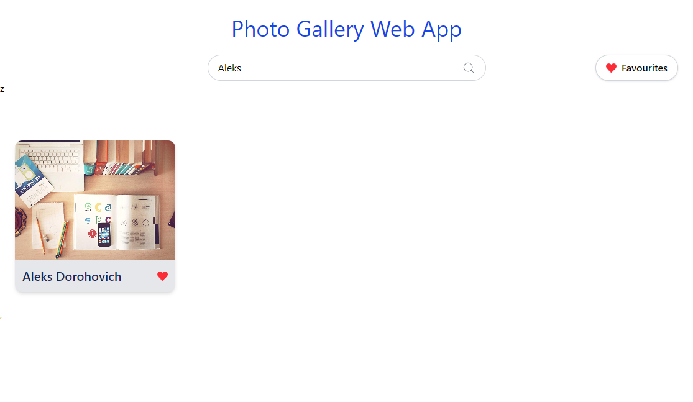
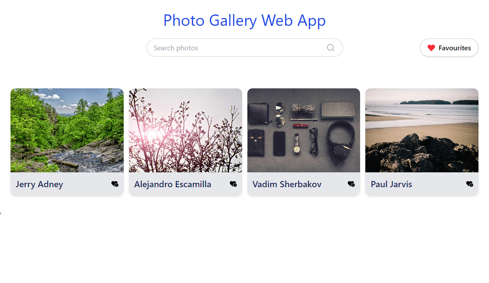

 Photo Gallery Web App

A responsive photo gallery built with React. Browse photos from the Lorem Picsum API, search by author, and save or remove favourites. Favourites are stored in the browser so they remain available after reloading the app.

## Screenshots

| Gallery | Search |
| --- | --- |
|  |  |

| Search results | Favourites |
| --- | --- |
|  |  |

 Tech Stack

- React and Vite
- React Router
- Redux Toolkit and React Redux
- Tailwind CSS
- Axios
-  Picsum API
